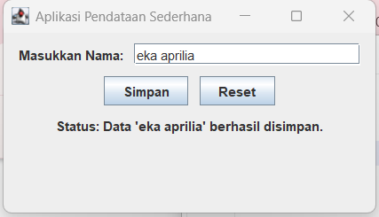
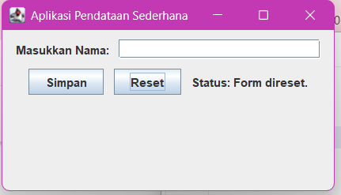

# Latihan_GUI

Repositori ini berisi tugas pembuatan Graphical User Interface (GUI) sederhana menggunakan Java Swing berdasarkan materi 10.

## Komponen yang Digunakan:
Pada kode `AplikasiGUI.java`, sudah diterapkan 5 syarat minimal komponen GUI:

1. **Top Level Container**: Menggunakan `JFrame` sebagai jendela utama aplikasi.
2. **Intermediate Container**: Menggunakan `JPanel` untuk mengelompokkan elemen-elemen form input agar lebih rapi.
3. **Atomic Component**: Menggunakan `JLabel` (untuk teks), `JTextField` (untuk kolom input teks), dan `JButton` (untuk tombol interaksi simpan & reset).
4. **Layout Manager**: Menggunakan `FlowLayout` yang di set rata tengah sehingga komponen tersusun berurutan secara horizontal maupun vertikal mengikuti ukuran frame.
5. **Event Handling (2 Interface)**:
   - `ActionListener`: Diterapkan pada tombol "Simpan" dan "Reset" untuk mendeteksi event klik dan memproses data.
   - `KeyListener`: Diterapkan pada `JTextField` untuk mendeteksi ketika pengguna sedang mengetik (event `keyReleased`), lalu meng update label status secara real time.

## Screenshot Aplikasi

